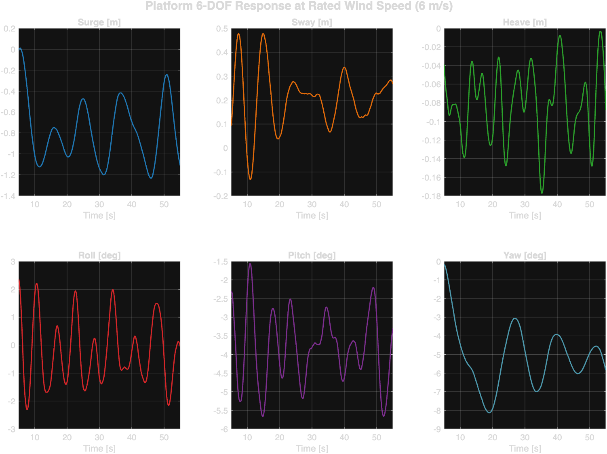
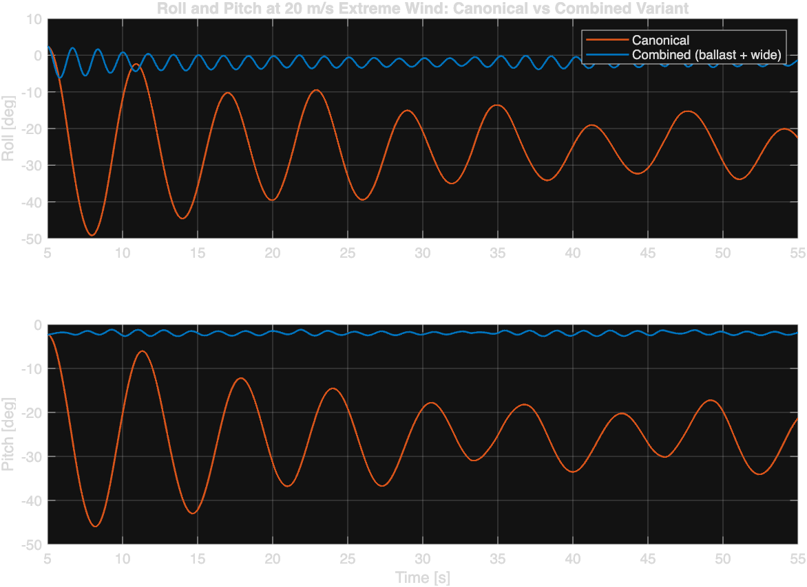

# Reduced-Order Aero-Hydrodynamic Modelling of Floating Offshore Multisource Renewable Energy Harvesters

[](LICENSE)
[](https://www.mathworks.com/products/matlab.html)
[](#how-it-works)
[](#modeling-assumptions-and-limitations)

A full 6-DOF coupled aero-hydrodynamic time-domain simulation of a hybrid Darrieus + Savonius vertical-axis wind turbine (VAWT) mounted on a floating platform with a 4-line spread mooring system. Written entirely in MATLAB, from raw ANSYS AQWA response data to a running coupled simulation, including a 20 m/s extreme-storm survivability study and three platform stability variants.

**Final Year Project, Department of Mechanical Engineering, Universiti Malaya.**



## What This Is

The concept is a multisource offshore energy harvester: a lift-based Darrieus rotor stacked with a drag-based Savonius rotor, sharing one floating platform. Survivability of such a platform depends on the coupling between rotor aerodynamics, wave-induced platform motion, and mooring restraint, and none of these can be simulated honestly in isolation.

This repository models that coupling end to end:

- **System identification from reference simulation data.** Natural frequencies via PSD peak detection (Welch's method), damping ratios via the half-power bandwidth method (capped to DNV-RP-C205 literature limits where forced-response data inflates them), and mooring stiffness via linear regression on 4-line tension projections.
- **Assembled linear 6-DOF model.** Mass (dry + DNV added mass), damping, and stiffness matrices combined into M·ẍ + C·ẋ + K·x: mooring regression provides surge/sway/yaw restoring terms, spectral ωn²·M provides heave/roll/pitch.
- **DMST + Chauvin aerodynamics.** Double-Multiple-Streamtube model for the Darrieus rotor (troposkein blade geometry, 10 streamtubes) and the Chauvin pressure-drag model for the Savonius rotor. The rotor speed is TSR-optimized at the rated wind speed (λ_opt = 4.75, Ω = 7.57 rad/s at 6 m/s; Cp = 0.476), and an aero-map (torque and thrust vs azimuth and wind speed) is sampled by bilinear interpolation at every 1 ms timestep. Turbulent inflow is synthesized from the IEC 61400-1 Kaimal spectrum with a deterministic gust on top.
- **Wave excitation extraction.** AQWA response data is inverted through the equations of motion (F = M·ẍ + C·ẋ + K·x) to reconstruct the wave excitation force time series, with the steady wind drag component removed.
- **Coupled simulation.** The full 6-DOF system is solved with `ode45` under simultaneous turbulent wind and extracted wave forcing, at rated (6 m/s) and extreme storm (20 m/s) conditions.
- **Stability variant study.** Three design variants (+500 kg ballast with 1.3× roll/pitch stiffness, 10× roll/pitch stiffness, and both combined at 13×) are compared against the baseline at 20 m/s against a 45° capsize threshold.
- **Interactive 3D visualization** of the simulation with an auto-detected wind/wave HUD, capsize detection, and a time slider.

## Results

All numbers below come from the exact dataset committed in `outputs/` and are reproduced by re-running the pipeline in [Getting Started](#getting-started).

### Rated condition: 6 m/s wind, Hs = 0.5 m, Tp = 10 s, 135° collinear

| DOF | Mean | Range | Unit |
|---|---|---|---|
| Surge | -0.79 | [-1.23, +0.01] | m |
| Sway | +0.21 | [-0.13, +0.48] | m |
| Heave | -0.08 | [-0.18, -0.00] | m |
| Roll | -0.31 | [-2.31, +2.37] | deg |
| Pitch | -3.87 | [-5.67, -1.56] | deg |
| Yaw | -5.15 | [-8.13, -0.17] | deg |

The platform is wind-dominated and dynamically stable: mean offsets match static force balance (surge: 328 N thrust / 361 N/m mooring stiffness predicts 0.91 m vs 0.79 m simulated, within 15%; yaw: -5.2° predicted vs -5.15° simulated), and nothing approaches the 45° capsize threshold.

### Extreme storm: 20 m/s wind, Ω = 25.23 rad/s

The baseline design capsizes: maximum roll reaches 49.1°, past the 45° capsize threshold. Three stability variants were simulated with identical wind and wave forcing:



| Configuration | Mean roll | Max \|roll\| | Mean pitch | Max \|pitch\| | Mean yaw |
|---|---|---|---|---|---|
| Canonical (baseline) | -24.2° | 49.1° | -25.1° | 46.0° | -66.1° |
| Ballast (+500 kg, 1.3× K_roll/pitch) | -18.8° | 38.7° | -19.5° | 35.3° | -65.2° |
| Wide (10× K_roll/pitch) | -2.4° | 7.3° | -2.5° | 3.4° | -63.3° |
| Combined (ballast + 13×) | -1.8° | 6.2° | -1.9° | 2.7° | -63.6° |

Ballast alone is the difference between capsize and survival, but the margin (6°) is narrow. The 10× stiffness variant cuts mean roll and pitch by 90%, because the equilibrium angle is θ = M_aero/K: stiffer hydrostatic restoration directly divides the overturning moment. The combined variant performs best overall (capsize margin above 39°) with ballast mainly reducing the dynamic oscillation amplitude. Mean surge (~-11 m, the mooring stretching under ~4.1 kN of storm thrust) barely changes across variants because K_surge is untouched.

**Note on the submitted thesis.** This project's final year report (Universiti Malaya, June 2026) documents the same framework from its submission-era run: canonical max roll -45.5° (mean -20.1°), combined mean roll -1.55°. The dataset committed here is a full end-to-end regeneration with the repository scripts; the current aerodynamic script's storm turbulence realization carries about 18% more mean thrust than the thesis-era one (4.08 vs 3.45 kN), which scales all storm angles by the same factor (~1.2). The conclusions are identical in both.

## How It Works

```
data/raw/*.csv  ──→ Clean_Dataset_Script.m  ──→ outputs/clean/           (Phase 1)
                                                             ↓
                    PSD_NaturalFrequency.m         → outputs/sysid/       (Phase 2)
                    Half_Power_Bandwidth_Damping.m →   ωn, ζ
                    Mooring_Stiffness_Extraction.m →   K_moor
                                                             ↓
                    Final_Matrix_Coefficients_MCK.m → MasterSystemData.mat (Phase 3)
                                                             ↓
                    Extract_Wave_Excitation.m  → outputs/forces/           (Phase 4)
                    DMST_Variable_Wind.m       →   wave + aero forces
                    DMST_Extreme_Wind.m        →   (20 m/s storm case)
                                                             ↓
                    Coupled_Simulation.m       → outputs/results/         (Phase 5)
                    Coupled_Simulation_20ms.m  →   (case argument selects
                    Run_20ms_*.m                   the M/C/K variant)
                                                             ↓
                    Check_Numerical_SelfConsistency.m                     (Phase 6)
                    Check_Geometry_K.m
                    Simulation_3D_new.m                                   (Phase 7)
```

**Phase details:**

1. **Data cleaning.** Digitized AQWA 6-DOF response and mooring tension data (Design 4, Case 1 from a previous study) are parsed, resampled, and exported as clean time series.
2. **System identification.** `pwelch` PSD peak detection gives natural frequencies per DOF; the half-power bandwidth method gives damping ratios, capped to DNV-RP-C205 and Faltinsen ranges when forced-response data overestimates them; linear regression on projected 4-line tensions (R_fairlead = 1.802 m, 45° fairlead angle) gives mooring stiffness.
3. **Matrix assembly.** Diagonal 6×6 M, C, K matrices: dry mass (1403 kg) plus DNV-RP-C205 added mass (20% surge/sway, 100% heave, 20% roll/pitch, 10% yaw), spectral ωn²·M stiffness for heave/roll/pitch, and regression stiffness for surge/sway/yaw. Variants re-assemble with modified mass or stiffness (Table: canonical / ballast / wide / combined).
4. **Forcing.** Wave excitation is reconstructed by inverting the equations of motion on the AQWA response. Aerodynamic torque and thrust come from the DMST + Chauvin aero-map driven by Kaimal-spectrum turbulent wind: U_mean = 6 m/s (gust 1.2·sin(0.5t), clamped [2,10] m/s) or 20 m/s (gust 4.0·sin(0.5t), clamped [10,22] m/s), I_ref = 0.14, integral length scale L₁ ≈ 1.12 m.
5. **Coupled solve.** `ode45` (RelTol 1e-4, AbsTol 1e-6) integrates M·ẍ + C·ẋ + K·x = F_wave + F_aero from the AQWA state at t = 5 s, on merged wave (dt = 0.1 s) and aero (dt = 0.001 s) force grids. This is a partial coupling: aerodynamic loads are imposed without feedback to the inflow.
6. **Validation.** A numerical self-consistency check (wave-only forcing vs the AQWA reference, per-DOF RMS below) and an independent geometry check (fairlead radius from mooring connection coordinates, implied GM from K_roll/K_pitch, mass/CG cross-checks against the thesis tables).
7. **Visualization.** `Simulation_3D_new(W, L, H_mast, csv)` renders the platform through the simulated motion with a direction-aware HUD.

## System Identification Results

Natural frequencies (PSD peak detection) and damping ratios (half-power bandwidth, capped):

| DOF | ωn (rad/s) | f (Hz) | ζ (used) | ζ raw (uncapped) |
|---|---|---|---|---|
| Surge | 0.742 | 0.118 | 15.0% | >30% |
| Sway | 0.741 | 0.118 | 15.0% | >30% |
| Heave | 0.826 | 0.132 | 5.0% | 93.1% |
| Roll | 1.046 | 0.166 | 5.0% | 62.7% |
| Pitch | 0.973 | 0.155 | 5.0% | 64.3% |
| Yaw | 0.598 | 0.095 | 10.0% | 69.9% |

Mooring stiffness (4-line tension regression): K_surge = 361.1 N/m, K_sway = 1680.0 N/m, K_yaw = 2379.3 N·m/rad.

The raw half-power bandwidth damping ratios on forced JONSWAP response data reach 62-93% on the rotational DOFs, which is physically impossible for this hull. The caps are explicit in `Half_Power_Bandwidth_Damping.m` (DNV-RP-C205, Faltinsen), not hidden.

## Validation

Numerical self-consistency check (`Check_Numerical_SelfConsistency.m`): the extracted wave forcing is fed back through the ODE with F_aero = 0 and compared against the original AQWA response.

| DOF | RMS error | RMS% | Result (<5%) |
|---|---|---|---|
| Surge | 0.0653 m | 21.86% | FAIL |
| Sway | 0.0142 m | 3.91% | PASS |
| Heave | 0.0004 m | 0.24% | PASS |
| Roll | 0.0001 rad | 0.32% | PASS |
| Pitch | 0.0001 rad | 0.37% | PASS |
| Yaw | 0.0000 rad | 0.08% | PASS |

Five of six DOFs pass. The Surge failure is structural to the check's design, not a defect: the check zeroes aerodynamic forcing while the AQWA reference response embeds the steady wind thrust, whose extracted surge component (23.3 N) against the soft 361 N/m mooring produces exactly the observed 0.065 m offset (23.3/361 = 0.065 m). A pass here proves solver accuracy and correctness of the equation of motion; it does not prove the identified M, C, K are physically correct, because any parameter error is absorbed into the extracted wave force by construction. The independent geometry check (`Check_Geometry_K.m`) verifies the fairlead radius against the mooring connection coordinates and confirms positive GM (GM_T = 1.00 m, GM_L = 1.15 m for the canonical matrices).

## Getting Started

Requirements: MATLAB (developed on R2025b) with the Signal Processing Toolbox (`pwelch`). No other dependencies; all data is in the repository.

```matlab
cd src

% 0. One-time: airfoil polar extrapolation (already run; output in data/airfoil/)
cd viterna; Viterna_Corrigan; cd ..

% 1. Clean raw AQWA data
Clean_Dataset_Script

% 2. System identification
PSD_NaturalFrequency
Half_Power_Bandwidth_Damping
Mooring_Stiffness_Extraction

% 3. Assemble M, C, K (canonical; variants: Final_Matrix_Coeff_Ballast / _Wide / _Combined)
Final_Matrix_Coefficients_MCK

% 4. Generate forcing
Extract_Wave_Excitation      % wave forces (re-run whenever M, C, K change)
DMST_Variable_Wind           % aero forces at 6 m/s rated
DMST_Extreme_Wind            % aero forces at 20 m/s storm

% 5. Coupled simulation
Coupled_Simulation           % rated case
Run_20ms_Canonical           % storm case, baseline M/C/K
Run_20ms_Ballast             % storm case, +500 kg + 1.3x stiffness
Run_20ms_Wide                % storm case, 10x stiffness
Run_20ms_Combined            % storm case, ballast + 13x stiffness

% 6. Validate + visualize
Check_Numerical_SelfConsistency
Check_Geometry_K
Simulation_3D_new(4, 4, 5, '../outputs/results/Final_Simulation_Results.csv')
```

## Repository Layout

```
├── src/                            # All pipeline scripts (run MATLAB from here)
│   ├── Clean_Dataset_Script.m      #   Phase 1: data cleaning
│   ├── PSD_NaturalFrequency.m      #   Phase 2: ωn via PSD peaks
│   ├── Half_Power_Bandwidth_Damping.m  #   Phase 2: ζ via half-power bandwidth
│   ├── Mooring_Stiffness_Extraction.m  #   Phase 2: K_moor regression
│   ├── Final_Matrix_Coefficients_MCK.m #   Phase 3: canonical M/C/K assembly
│   ├── Final_Matrix_Coeff_{Ballast,Wide,Combined}.m  #   stability variants
│   ├── Extract_Wave_Excitation.m   #   Phase 4: inverse-EoM wave forces
│   ├── DMST_Variable_Wind.m        #   Phase 4: DMST + Chauvin aero, 6 m/s
│   ├── DMST_Extreme_Wind.m         #   Phase 4: DMST + Chauvin aero, 20 m/s
│   ├── Coupled_Simulation.m        #   Phase 5: coupled solve, rated case
│   ├── Coupled_Simulation_20ms.m   #   Phase 5: coupled solve, storm case
│   ├── Run_20ms_{Canonical,Ballast,Wide,Combined}.m  #   storm-case runners
│   ├── Check_Numerical_SelfConsistency.m  # Phase 6: numerical smoke test
│   ├── Check_Geometry_K.m          #   Phase 6: R_fairlead + GM verification
│   ├── Simulation_3D_new.m         #   Phase 7: 3D visualization
│   └── viterna/Viterna_Corrigan.m  #   360° airfoil polar extrapolation
├── data/
│   ├── raw/                        # Digitized AQWA response + tension data
│   └── airfoil/                    # NACA 0009 polar tables (raw + 360° extrapolated)
├── outputs/
│   ├── clean/                      # Phase 1 cleaned time series
│   ├── sysid/                      # Phase 2-3 identified parameters (.mat)
│   ├── forces/                     # Phase 4 extracted wave + aero forces
│   └── results/                    # Phase 5 coupled simulation results
└── assets/                         # Figures regenerated from the committed results
```

## Modeling Assumptions and Limitations

Stated plainly, because this is a reduced-order model and the limits matter:

- **Diagonal M, C, K.** Cross-coupling between DOFs is neglected; each DOF is a single-DOF oscillator driven by its force component. This is the core reduction that makes the model tractable.
- **Partial coupling.** Aerodynamic loads are imposed on the hydrodynamic model without feedback to the inflow; platform motion does not alter the relative wind velocity seen by the rotor.
- **Damping is capped, not measured.** The half-power method on forced-response data overestimates ζ. The caps (DNV-RP-C205, Faltinsen) are a deliberate engineering judgment, and the raw values are printed by the script.
- **Wave excitation is inverse-reconstructed, not independently measured.** F_wave = M·ẍ + C·ẋ + K·x applied to AQWA data propagates any M, C, K error into the forcing. It is uncertainty propagation by construction.
- **Wave heading is locked.** The extracted forcing embeds the AQWA run's 135° heading; rotating it would be physically invalid since the RAO is direction-dependent.
- **Linearized mooring.** K_moor is a small-amplitude linearization of a catenary system; the 11 m storm surge offsets sit well outside the identification amplitude range, so storm surge magnitude carries that uncertainty.
- **Storm turbulence realization.** The 20 m/s capsize case is sensitive to the turbulent wind realization; peak angles move between runs of the framework, while the mean offsets (set by mean aero moment / stiffness) are stable.

## AI Agentic Development

This project was built with an agentic AI workflow as a core part of its methodology. The full MATLAB pipeline was implemented, debugged, and iterated by Claude Code (Anthropic) operating as a coding agent, under the author's direction: the author set the engineering methodology, physical assumptions, and validation strategy, and interpreted all results. The agent carried out MATLAB implementation, numerical debugging, and documentation. The development loop itself was agentic: tasks were specified in natural language, implemented, validated against the AQWA reference data, and revised across sessions.

## Author

**D. Desmaan** — Final Year Project, Department of Mechanical Engineering, Universiti Malaya (2025/2026)

## License

Released under the [MIT License](LICENSE).
